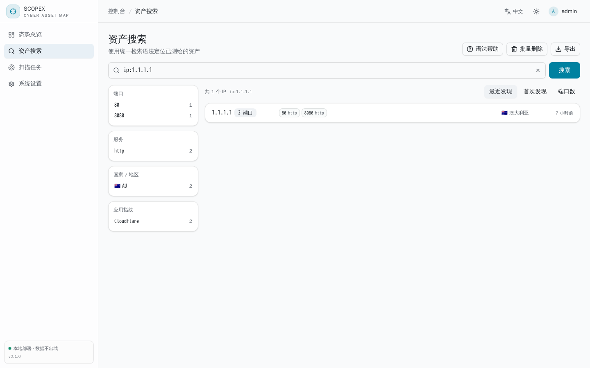
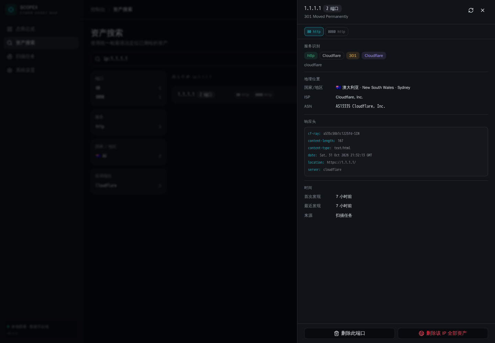
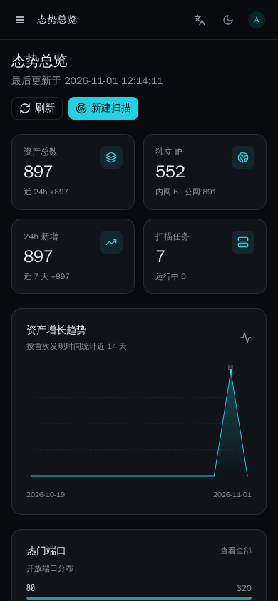

# Scopex · Network Asset Mapping Engine

[简体中文](README.md) | English

[](https://github.com/expvintl/scopex/actions/workflows/ci.yml)
[](https://github.com/expvintl/scopex/actions/workflows/release.yml)
[](LICENSE)

An asset discovery and fingerprinting platform for **networks you own**: a Go backend plus a React console, with everything stored in MongoDB and a single query language to locate exposed surfaces. The frontend is embedded into the binary, so deployment is a single file.

> [!WARNING]
> This project is intended **for learning, research and operating your own network only**. Scan only targets you are explicitly authorized to test. Unauthorized port scanning of internet hosts may violate local laws and regulations; you are solely responsible for your actions. See the [disclaimer](#disclaimer) below.

## Screenshots

| Asset search (grouped by IP) | Asset detail |
| --- | --- |
|  |  |



## Features

- **Multiple discovery engines**: built-in Go TCP scanner (no privileges required), Masscan (high-speed discovery of large ranges, needs root or `CAP_NET_RAW`), Nmap (service and version detection)
- **Local geolocation database**: pulls the public DB-IP Lite mmdb files on startup and resolves country/region/city plus ASN entirely offline, with no third-party query API; download URLs are configurable in the console and support the `{month}` placeholder
- **Minecraft server detection**: uses the server list ping protocol to read the Java Edition version, online player count and icon (the favicon participates in mmh3 search like any other asset)
- **Native fingerprinting**: 50+ web application signatures (WordPress / ThinkPHP / Spring Boot / Shiro / BT Panel / Weaver / Hikvision and more), TLS certificate parsing, favicon md5 and mmh3 hashes, banner-based protocol identification (SSH / FTP / MySQL / Redis / VNC / Telnet / PostgreSQL / RDP / MongoDB / rsync / AMQP-RabbitMQ) and active protocol probes (SMB 2.x/3.x dialects with NTLMSSP host/domain/OS, WinRM OS version, Minecraft MOTD and player count, Mumble version and OS)
- **Passive OS detection**: infers the operating system from the SSH software string, SMB/WinRM negotiation results and the HTTP `Server` header, without active `-O` scanning
- **Query language**: `app:nginx && country:CN`, `port:[80 TO 8080]`, `ip:192.168.6.0/24`, `title:"admin"`, with `&&`, `||`, `!` and parentheses
- **Task scheduling**: queued target-range tasks, phase progress (port discovery → fingerprinting → service detection), live logs, cancellation and recovery after restart
- **IP-grouped asset view**: results are one row per IP with ports as tags, collapsed into `+N` beyond eight, and a detail drawer to switch ports and inspect fingerprints, certificates and response headers; countries are shown with flag icons
- **One-click refresh**: re-probe every recorded port of a single IP from the drawer, refreshing geolocation as well — handy for re-checking existing results
- **Bulk cleanup**: clear all finished/failed/cancelled/interrupted tasks in one action; delete assets matching a `192.168.*.*` wildcard or a CIDR block
- **Management console**: overview dashboard, asset search with facet filters, CSV/JSON export, user and API key management, and admin deletion of a single asset or a whole IP
- **Bilingual UI**: every frontend string and server-side message (API errors, query syntax docs, task logs, engine status) is available in Chinese and English, following the browser language by default; switching takes effect immediately and updates both `<html lang>` and the `Accept-Language` request header
- **Theming and responsiveness**: system / light / dark themes (remembered locally, instant switching, no flash), and a console that stays fully usable on phones and tablets with drawer navigation and single-column cards
- **Controllable scan egress**: choose which interface probe traffic leaves from (default route and gateway MAC are auto-detected), and give masscan a custom interface, gateway MAC or extra arguments
- **Configurable denied ranges**: add or remove CIDR blocks, IPs and ranges in the console; matching tasks are rejected before port discovery and the change applies to new tasks immediately
- **Default ports and rate**: the task dialog pre-fills ports from the saved default list (supporting a mix of `80,443` and `1-1024`) instead of retyping them every time
- **Single-binary deployment**: the built frontend is packaged into the server with `go:embed`

## Tech stack

| Layer | Choice |
| --- | --- |
| Backend | Go, Gin, mongo-driver, JWT, bcrypt |
| Storage | MongoDB 6+ |
| Frontend | React 19, Vite 6, TypeScript, Tailwind CSS v4, shadcn/ui (Radix UI) |
| External tools | nmap (service detection), masscan (optional, requires privileges) |

## Quick start

### 1. Download a release

Grab the archive for your platform from [Releases](https://github.com/expvintl/scopex/releases) (`linux` / `darwin` / `windows` × `amd64` / `arm64`) and run the single binary — the frontend is already embedded.

### 2. Build from source

```bash
git clone https://github.com/expvintl/scopex.git && cd scopex

# Frontend (output goes to backend/web/dist)
cd frontend && npm install && npm run build

# Backend (embeds the frontend assets)
cd ../backend && go build -trimpath -o ../bin/scopex ./cmd/server
```

`make build` does the same in one step.

### 3. Prepare MongoDB and run

```bash
mongod --dbpath ./data --port 27017 --bind_ip 127.0.0.1 --fork --logpath ./log/mongod.log
SCOPEX_ADMIN_PASS='change-me' ./bin/scopex
```

The administrator account is created on first start (username `admin`). If `SCOPEX_ADMIN_PASS` is unset, a random password is printed to the startup log.

Open <http://127.0.0.1:8088> to reach the console.

### Frontend development

```bash
cd frontend && npm run dev     # http://127.0.0.1:5173, /api proxied to :8088
```

Start the backend with `SCOPEX_DEV_MODE=1` to relax CORS while developing.

## Configuration

Everything is configured through environment variables:

| Variable | Default | Description |
| --- | --- | --- |
| `SCOPEX_LISTEN` | `:8088` | HTTP listen address |
| `SCOPEX_MONGO_URI` | `mongodb://127.0.0.1:27017` | MongoDB connection string |
| `SCOPEX_MONGO_DB` | `scopex` | Database name |
| `SCOPEX_JWT_SECRET` | development default | JWT signing key — change in production |
| `SCOPEX_TOKEN_TTL` | `12h` | Login token lifetime |
| `SCOPEX_ADMIN_USER` / `SCOPEX_ADMIN_PASS` | `admin` / random | Initial administrator |
| `SCOPEX_MAX_TARGETS` | `65536` | Maximum addresses per task |
| `SCOPEX_MAX_RATE` | `20000` | Maximum packets per second per task |
| `SCOPEX_MAX_CONCURRENCY` | `512` | Maximum scan concurrency |
| `SCOPEX_DENY_CIDRS` | `224.0.0.0/4,240.0.0.0/4` | Denied ranges used on first start; once settings are saved in the console, the stored list wins |
| `SCOPEX_NMAP_PATH` / `SCOPEX_MASSCAN_PATH` | auto-detected | External tool paths |
| `SCOPEX_GEO_ENABLED` | `true` | Enable local geolocation |
| `SCOPEX_GEO_DIR` | `data/geoip` | Directory for the geolocation databases |
| `SCOPEX_GEO_AUTO_DOWNLOAD` | `true` | Download when missing or older than 35 days |
| `SCOPEX_GEO_CITY_URL` | DB-IP city lite | City database URL, `{month}` expands to the current month |
| `SCOPEX_GEO_ASN_URL` | DB-IP asn lite | ASN database URL, `{month}` expands to the current month |
| `SCOPEX_DEV_MODE` | `false` | Development mode (relaxes CORS) |

## Query syntax

| Example | Meaning |
| --- | --- |
| `app:nginx` | Application fingerprint or product name contains nginx |
| `port:443`, `port:[80 TO 8080]` | Exact port or a range |
| `ip:192.168.6.0/24`, `ip:10.0.0.1` | Network range or single IP |
| `country:CN`, `city:Hangzhou` | Geolocation |
| `service:ssh`, `server:nginx` | Service name or `Server` response header |
| `title:"admin panel"`, `banner:"OpenSSH"` | Title or banner text |
| `cert:example.com` | Certificate subject, issuer or SAN |
| `favicon:-123456789` | favicon mmh3 hash |
| `last_seen:7d` | Updated within the last 7 days |
| `app:nginx && country:CN`, `port:22 \|\| port:3389` | Boolean composition with parentheses and negation |

The full field list lives in the console under “Asset search → Query syntax” or at `GET /api/meta/query-syntax`.

## HTTP API

Every endpoint except login requires `Authorization: Bearer <token>` or `X-API-Key: <key>`.

| Method | Path | Description |
| --- | --- | --- |
| POST | `/api/auth/login` | Exchange credentials for a token |
| GET | `/api/hosts` | Search assets (`q` / `page` / `size` / `sort`); add `group=ip` to group by IP |
| GET | `/api/ips/:ip` | All port assets of one IP |
| POST | `/api/ips/:ip/refresh` | Re-probe recorded ports of this IP and refresh geolocation |
| GET | `/api/hosts/facets` | Port, service, country and application facets |
| GET | `/api/hosts/:id` | Asset detail |
| GET | `/api/hosts/:id/favicon` | favicon image |
| DELETE | `/api/hosts/:id` | Delete one asset (admin) |
| DELETE | `/api/hosts?ip=<ip>` | Delete every asset of one IP (admin) |
| DELETE | `/api/hosts?cidr=<cidr>` | Delete assets by CIDR block (admin) |
| DELETE | `/api/hosts?pattern=<glob>` | Delete assets by wildcard, e.g. `192.168.*.*` (admin) |
| GET | `/api/hosts/export` | Export CSV or JSON (`format=csv`) |
| GET/POST | `/api/tasks` | List or create tasks |
| GET | `/api/tasks/:id` | Task detail and running state |
| GET | `/api/tasks/:id/logs` | Incremental task logs (`after` sequence) |
| POST | `/api/tasks/:id/cancel` | Cancel a task |
| DELETE | `/api/tasks` | Clear finished tasks and their logs (admin; running tasks are kept) |
| DELETE | `/api/tasks/:id` | Delete a task (admin) |
| GET | `/api/stats/overview` | Dashboard statistics |
| GET | `/api/system/tools` | Engine availability and limits |
| GET | `/api/system/scan-settings` | Scan interface, masscan options, default ports and local interfaces |
| PUT | `/api/system/scan-settings` | Save scan settings (admin) |
| GET | `/api/system/geo` | Geolocation database status and download sources |
| PUT | `/api/system/geo` | Save geolocation settings (admin) |
| POST | `/api/system/geo/refresh` | Download the latest geolocation databases (admin) |
| GET/POST | `/api/users` | List or create users (admin) |

## Scan engines

- `auto`: uses masscan when the target count is ≥ 256 and masscan is available, otherwise the built-in TCP scanner
- `native`: a Go connect scanner that runs unprivileged and handles tens of thousands of ports
- `masscan`: needs root or `CAP_NET_RAW`; ideal for fast discovery across large ranges, and falls back automatically with a warning when unavailable
- `nmap`: service and version detection only; enabling “Deep detection” on a task runs `-sV` against the discovered ports

Tasks are scheduled by a background worker pool. `GET /api/system/tools` reports which engines are usable in the current environment.

### Scan egress and masscan options

“Settings → Scan network” selects the interface used for probe traffic. Leaving it empty follows the system route; the built-in scanner binds the interface's source address and nmap receives the same interface via `-e`. The “detect automatically” action reads the default route and, when possible, the gateway MAC from the ARP neighbour table.

masscan accepts its own interface, gateway MAC and extra arguments (for example `--retries 3 --wait 3`). When scanning devices beyond the local segment, missing responses usually mean the gateway MAC needs to be set explicitly. Extra arguments are split on spaces and appended after the defaults; output-related flags (`-o*`, `--output-*`) are ignored so result parsing stays intact.

“Default ports” on the same page decides the initial port list of a new task: the task dialog pre-fills it, an empty field falls back to this setting, and an empty setting falls back to the built-in `80,443,8080,8443`.

### Geolocation databases

The “Geolocation” card under “Settings → Scan engines” shows the database build date, ASN database status and the last error, and lets you change both download URLs, toggle automatic updates or trigger a download manually.

## Internationalization

The console ships with Chinese and English strings and a three-state language menu in the header:

| Option | Behaviour |
| --- | --- |
| Auto detect (default) | Follows `navigator.languages`, falling back to English outside Chinese locales |
| 中文 | Forces Simplified Chinese |
| English | Forces English |

The choice is stored in `localStorage['scopex.lang']` and survives reloads and re-login. Switching updates `<html lang>` and attaches the current language to every API request as `Accept-Language`. Frontend strings use the Chinese original as the dictionary key (`frontend/src/lib/i18n.tsx`), so a missing entry falls back to Chinese instead of rendering blank.

The server localizes the same way, which means query syntax docs, API errors and task logs arrive already translated:

- `backend/internal/i18n`: language negotiation, an English catalogue keyed by the Chinese original (`catalog.go`), and a translatable `*i18n.Error` that keeps its format string and arguments and picks the language at render time
- The API layer translates through `fail` / `failf`; `/api/meta/query-syntax` returns localized field descriptions and examples; `/api/system/tools` returns localized purposes and unavailability reasons
- Task logs record the negotiated language as `task.lang` when the task is created, and every subsequent log line is written in that language (history keeps the language it was created with)
- Anything missing from the catalogue falls back to Chinese, never to an empty string

## Repository layout

```
backend/
  cmd/server/           entry point
  internal/api/         HTTP routes and handlers
  internal/job/         task scheduling, progress and logs
  internal/scanner/     port discovery (native / masscan / nmap)
  internal/fingerprint/ signature rules, favicon hashing, protocol probes
  internal/query/       query parsing and MongoDB filter compilation
  internal/store/       MongoDB access layer and indexes
  internal/geo/         IP geolocation
  internal/i18n/        server-side localization
  internal/version/     build version (injected via ldflags)
  web/                  embedded frontend assets
frontend/
  src/pages/            dashboard / search / tasks / settings
  src/components/       layout and shared components
  src/lib/              API client, i18n, theme
docs/screenshots/       README images
.github/workflows/      CI and multi-platform releases
```

## Development and releases

```bash
make build     # frontend + backend
make test      # go test ./...
make vet       # go vet ./...
make run       # build and start
```

Pushes to `main` and pull requests run CI: `go vet`, `go test`, `go build`, plus frontend type checking and build.

Releases are handled by `.github/workflows/release.yml`: pushing a `v*` tag builds static binaries (`CGO_ENABLED=0`, `-trimpath`, injected version) for `linux`/`darwin`/`windows` × `amd64`/`arm64`, packages them as `tar.gz` / `zip` and publishes them to Releases.

```bash
git tag v0.1.0
git push origin v0.1.0
```

## Disclaimer

1. This project is **for learning, research and operating your own network only**. It is not a commercial product or a security service.
2. Scan only targets you are **explicitly authorized** to test. Unauthorized port scanning, service probing or fingerprinting of third-party systems may violate the laws and regulations of your jurisdiction, including but not limited to the Cybersecurity Law of the People's Republic of China.
3. The built-in default denied ranges (multicast and reserved addresses) only prevent accidental scans and are not a compliance control. You are responsible for configuring and verifying your scan scope.
4. **You bear sole responsibility** for any direct or indirect consequences of using this project, including but not limited to legal disputes, data loss or service disruption. The authors and contributors accept no liability.
5. This project is provided “as is”, without warranty of any kind, express or implied.

## License

[MIT](LICENSE)
