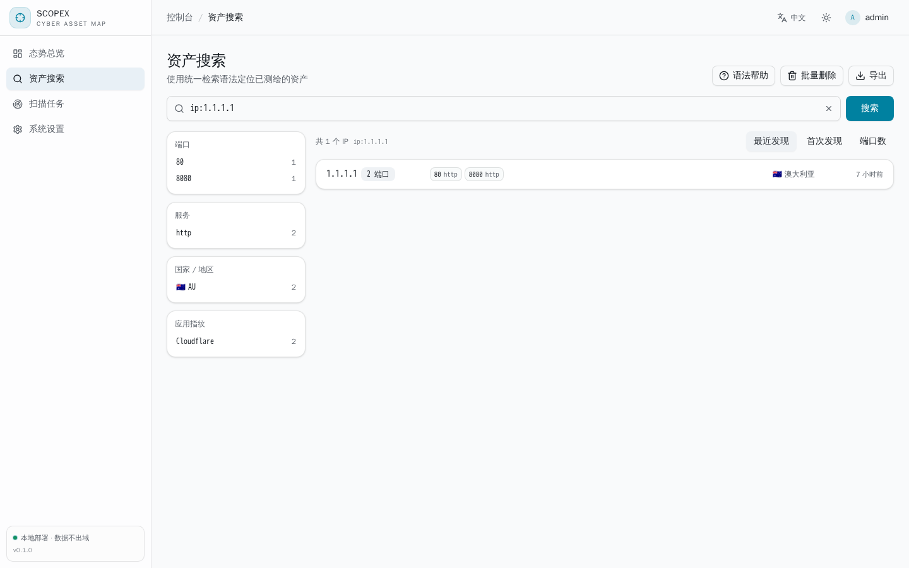
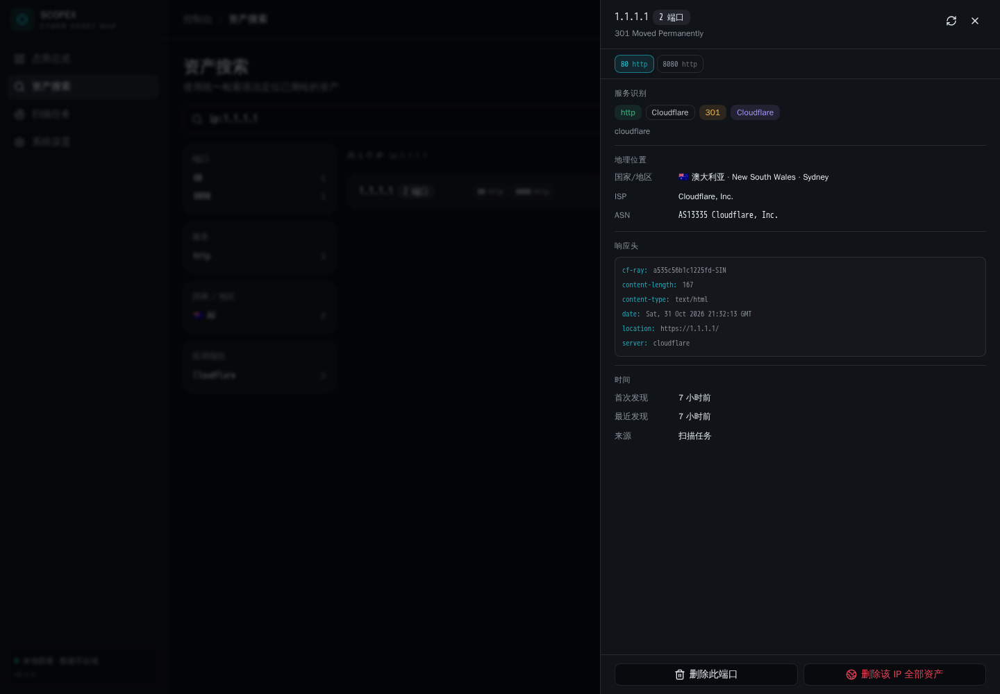
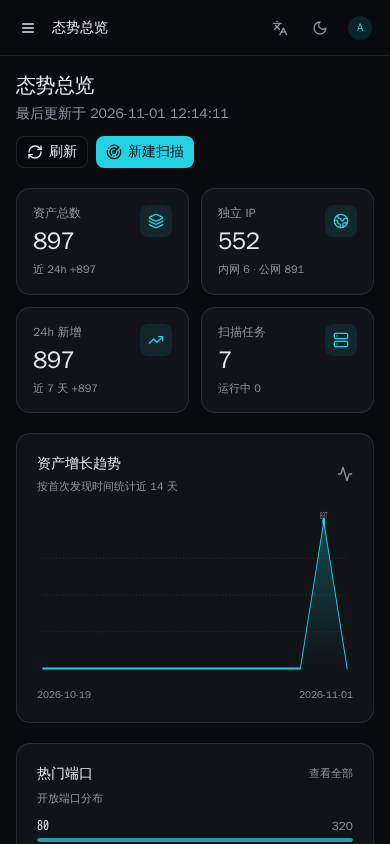

# Scopex · 网络空间资产测绘引擎

简体中文 | [English](README.en.md)

[](https://github.com/expvintl/scopex/actions/workflows/ci.yml)
[](https://github.com/expvintl/scopex/actions/workflows/release.yml)
[](LICENSE)

面向**自有网络**的资产发现与指纹识别平台：Go 后端 + React 控制台，扫描结果统一存入 MongoDB，通过一套检索语法定位暴露面。前端产物嵌入二进制，单文件即可部署。

> [!WARNING]
> 本项目仅供**学习、研究与自有网络运维**使用。请仅对已获得明确授权的目标执行扫描。未经授权对公网主机进行端口探测可能违反当地法律法规，使用者需自行承担全部责任。详见文末[免责声明](#免责声明)。

## 截图

| 资产检索（按 IP 聚合） | 资产详情 |
| --- | --- |
|  |  |



## 功能

- **多引擎端口探测**：内置 Go TCP 扫描器（无需 root）、Masscan（超大范围高速发现，需要 root 或 `CAP_NET_RAW`）、Nmap（服务与版本识别）
- **本地归属地库**：启动时自动拉取公开的 DB-IP Lite（mmdb）离线库，本地解析国家/省市与 ASN，不依赖任何在线查询接口；下载地址可在控制台自定义，支持 `{month}` 占位符与手动更新
- **Minecraft 服务器识别**：按服务器列表 ping 协议读取 Java 版版本、在线人数与图标（favicon 同样参与 mmh3 检索）
- **原生指纹识别**：50+ Web 应用指纹（WordPress / ThinkPHP / Spring Boot / Shiro / 宝塔 / 泛微 / 海康等）、TLS 证书解析、favicon md5 与 mmh3 哈希、协议 banner 识别（SSH / FTP / MySQL / Redis / VNC / Telnet / PostgreSQL / RDP / MongoDB / rsync / AMQP-RabbitMQ）与主动协商指纹（SMB 2.x/3.x 方言与 NTLMSSP 主机名/域/系统版本、WinRM 系统版本、Minecraft 服务器 MOTD/玩家数、Mumble 版本与系统）
- **被动系统识别**：从 SSH 软件名、SMB/WinRM 协商结果与 HTTP `Server` 头推断操作系统，不做主动 `-O` 探测
- **检索语法**：`app:nginx && country:CN`、`port:[80 TO 8080]`、`ip:192.168.6.0/24`、`title:"后台"`，支持 `&& || !` 与括号
- **任务化调度**：目标段任务队列、阶段进度（端口发现 → 指纹识别 → 服务识别）、实时日志、取消与重启恢复
- **按 IP 聚合的资产视图**：搜索结果以 IP 为单位，端口以标签列出，超过 8 个折叠为 `+N`，详情抽屉内可切换端口查看指纹、证书与响应头；国家/地区带国旗标识
- **一键刷新**：详情抽屉右上角可对单个 IP 重新探测全部已记录端口并刷新归属地，适合复核存量结果
- **AI 推理服务主动指纹**：对疑似模型服务端口按产品特性接口逐一验证，识别 Ollama（版本/模型清单）、ComfyUI、Stable Diffusion WebUI、Text Generation WebUI、llama.cpp、OpenAI 兼容 API、Open WebUI、Jupyter、Qdrant，并顺带探测 Docker Engine、Kubernetes、etcd、ClickHouse、InfluxDB、Consul、RabbitMQ、Grafana 的未鉴权接口；命中结果写入资产详情（产品、版本、类型、模型、运行环境、风险备注），并把设备角色标为 `AI 节点`
- **全球数据汇总**：独立页面按大洲、国家/地区、服务类型、操作系统、应用品类、AI 服务、设备类型、ASN 组织与端口做分布统计，纯 SVG 环形图 + 排行条，点击任一分类可直接跳转到对应检索语法；另附暴露面提示（AI 服务、容器编排、数据库未鉴权）
- **批量清理**：任务页可一键清空已完成/失败/取消/中断的任务；资产页支持按 `192.168.*.*` 通配符或 CIDR 一次性删除匹配的资产
- **可视化控制台**：态势总览、资产搜索与详情抽屉、facet 聚合筛选、全球数据汇总、CSV/JSON 导出、用户与 API Key 管理、管理员可按单条资产或整个 IP 删除结果
- **中英双语界面**：前端文案与服务端消息（接口错误、查询语法说明、任务日志、引擎状态）均支持中文 / English，默认跟随浏览器语言；语言切换即时生效，`<html lang>` 与 `Accept-Language` 请求头同步更新
- **主题与响应式**：跟随系统 / 亮色 / 暗色三态主题（本地记忆、即时切换、无闪烁），控制台在手机与平板上以抽屉式导航和单列卡片完整可用
- **可控的扫描出口**：可指定探测流量从哪块网卡发出（自动探测默认路由与网关 MAC），masscan 支持自定义网卡、网关 MAC 与额外参数
- **可配置的禁止扫描网段**：控制台内可增删 CIDR / IP / 区间，命中任一条的任务在端口发现前即被拒绝，保存后对新任务立即生效
- **默认端口与速率**：新建任务时端口框自动带入设置里保存的默认端口列表（支持 `80,443` 与 `1-1024` 混写），无需每次重输
- **单二进制部署**：前端构建产物通过 `go:embed` 打包进服务端

## 技术栈

| 层 | 选型 |
| --- | --- |
| 后端 | Go、Gin、mongo-driver、JWT、bcrypt |
| 存储 | MongoDB 6+ |
| 前端 | React 19、Vite 6、TypeScript、Tailwind CSS v4、shadcn/ui（Radix UI） |
| 外部工具 | nmap（服务识别）、masscan（可选，需特权） |

## 快速开始

### 1. 下载预编译版本

前往 [Releases](https://github.com/expvintl/scopex/releases) 下载对应平台的压缩包（`linux` / `darwin` / `windows` × `amd64` / `arm64`），解压后直接运行单个二进制即可，前端资源已内嵌。

### 2. 从源码构建

```bash
git clone https://github.com/expvintl/scopex.git && cd scopex

# 前端（产物输出到 backend/web/dist）
cd frontend && npm install && npm run build

# 后端（内嵌前端资源）
cd ../backend && go build -trimpath -o ../bin/scopex ./cmd/server
```

也可以直接用 `make build`（等价于上面两步）。

### 3. 准备 MongoDB 并运行

```bash
mongod --dbpath ./data --port 27017 --bind_ip 127.0.0.1 --fork --logpath ./log/mongod.log
SCOPEX_ADMIN_PASS='换成你的密码' ./bin/scopex
```

首次启动会创建管理员账号（默认 `admin`）。未设置 `SCOPEX_ADMIN_PASS` 时，随机初始密码只出现这一次，会以 `====` 方框醒目打印在屏幕上，同时也写进日志文件（默认 `data/logs/scopex.log`）：

```
==============================================================
  首次安装：已创建管理员账号
    用户名: admin
    密码:   rGG89WDAxNmYHx
    提示: 登录后请立即修改密码
==============================================================
```

打开 <http://127.0.0.1:8088> 进入控制台。

### 前端开发模式

```bash
cd frontend && npm run dev     # http://127.0.0.1:5173，/api 代理到 :8088
```

后端以 `SCOPEX_DEV_MODE=1` 启动时会放开 CORS，便于前后端分离调试。

## 配置

全部通过环境变量：

| 变量 | 默认值 | 说明 |
| --- | --- | --- |
| `SCOPEX_LISTEN` | `:8088` | HTTP 监听地址 |
| `SCOPEX_MONGO_URI` | `mongodb://127.0.0.1:27017` | MongoDB 连接串 |
| `SCOPEX_MONGO_DB` | `scopex` | 数据库名 |
| `SCOPEX_JWT_SECRET` | 自动生成并存入数据库 | JWT 签名密钥；多实例部署时请显式指定，保证各实例一致 |
| `SCOPEX_TOKEN_TTL` | `24h` | 登录令牌有效期（账号被删、改密码、改角色、数据库重置都会让令牌立即失效，与 TTL 无关） |
| `SCOPEX_ADMIN_USER` / `SCOPEX_ADMIN_PASS` | `admin` / 随机 | 初始管理员 |
| `SCOPEX_MAX_TARGETS` | `65536` | 单任务最大目标地址数 |
| `SCOPEX_MAX_RATE` | `20000` | 单任务速率上限（包/秒） |
| `SCOPEX_MAX_CONCURRENCY` | `512` | 扫描并发上限 |
| `SCOPEX_DENY_CIDRS` | `224.0.0.0/4,240.0.0.0/4` | 首次启动使用的禁止扫描网段；控制台保存过设置后以数据库中的配置为准 |
| `SCOPEX_NMAP_PATH` / `SCOPEX_MASSCAN_PATH` | 自动查找 | 外部工具路径 |
| `SCOPEX_GEO_ENABLED` | `true` | 是否启用本地归属地解析 |
| `SCOPEX_GEO_DIR` | `data/geoip` | 归属地库文件目录 |
| `SCOPEX_GEO_AUTO_DOWNLOAD` | `true` | 库缺失或超过 35 天时自动下载 |
| `SCOPEX_GEO_CITY_URL` | DB-IP city lite | 城市库下载地址，`{month}` 替换为当前月份 |
| `SCOPEX_GEO_ASN_URL` | DB-IP asn lite | ASN 库下载地址，`{month}` 替换为当前月份 |
| `SCOPEX_DEV_MODE` | `false` | 开发模式（放开 CORS） |
| `SCOPEX_LOG_FILE` | `data/logs/scopex.log` | 明细日志文件；填 `off` 只在屏幕输出 |
| `SCOPEX_LOG_LEVEL` | `info` | 写入日志文件的最低级别（`debug`/`info`/`warn`/`error`） |
| `SCOPEX_LOG_CONSOLE_LEVEL` | `warn` | 打印到屏幕的最低级别；启动、就绪、初始密码等关键信息不受此限制 |
| `SCOPEX_LOG_MAX_MB` / `SCOPEX_LOG_BACKUPS` | `20` / `3` | 单个日志文件上限与保留份数（轮转为 `.1`、`.2`…） |

屏幕上只显示启动、就绪、错误等关键信息；每条 HTTP 请求、扫描工具探测、任务明细都写进日志文件，排查问题时看文件即可：

```bash
tail -f data/logs/scopex.log
```

## 查询语法

| 示例 | 含义 |
| --- | --- |
| `app:nginx` | 应用指纹或产品名包含 nginx |
| `port:443`、`port:[80 TO 8080]` | 端口精确匹配 / 区间 |
| `ip:192.168.6.0/24`、`ip:10.0.0.1` | 网段或单 IP |
| `country:CN`、`city:杭州` | 地理位置 |
| `service:ssh`、`server:nginx` | 服务名 / 响应头 Server |
| `title:"管理后台"`、`banner:"OpenSSH"` | 标题 / banner 文本 |
| `cert:example.com` | 证书主体、颁发者或 SAN |
| `favicon:-123456789` | favicon mmh3 哈希 |
| `last_seen:7d` | 最近 7 天内有更新 |
| `app:nginx && country:CN`、`port:22 \|\| port:3389` | 逻辑组合，支持括号与取反 |

完整字段列表见控制台「资产搜索 → 查询语法」或 `GET /api/meta/query-syntax`。

## HTTP API

除登录外均需认证：`Authorization: Bearer <token>` 或 `X-API-Key: <key>`。

| 方法 | 路径 | 说明 |
| --- | --- | --- |
| POST | `/api/auth/login` | 登录获取令牌 |
| GET | `/api/hosts` | 资产检索（`q` / `page` / `size` / `sort`），加 `group=ip` 按 IP 聚合 |
| GET | `/api/ips/:ip` | 某个 IP 下的全部端口资产 |
| POST | `/api/ips/:ip/refresh` | 重新探测该 IP 已记录的端口并刷新归属地 |
| GET | `/api/hosts/facets` | 端口、服务、国家、应用聚合 |
| GET | `/api/hosts/:id` | 资产详情 |
| GET | `/api/hosts/:id/favicon` | favicon 图片 |
| DELETE | `/api/hosts/:id` | 删除单条资产（管理员） |
| DELETE | `/api/hosts?ip=<ip>` | 删除该 IP 下的全部资产（管理员） |
| DELETE | `/api/hosts?cidr=<cidr>` | 按网段批量删除资产（管理员） |
| DELETE | `/api/hosts?pattern=<通配符>` | 按通配符批量删除资产，如 `192.168.*.*`（管理员） |
| GET | `/api/hosts/export` | 导出 CSV / JSON（`format=csv`） |
| GET/POST | `/api/tasks` | 任务列表 / 创建任务 |
| GET | `/api/tasks/:id` | 任务详情与运行状态 |
| GET | `/api/tasks/:id/logs` | 增量拉取任务日志（`after` 序号） |
| POST | `/api/tasks/:id/cancel` | 取消任务 |
| DELETE | `/api/tasks` | 清空已结束的任务与日志（管理员，运行中的保留） |
| DELETE | `/api/tasks/:id` | 删除任务（管理员） |
| GET | `/api/stats/overview` | 总览统计 |
| GET | `/api/system/tools` | 扫描引擎可用性与限制 |
| GET | `/api/system/scan-settings` | 扫描网卡、masscan 参数、默认端口与本机网卡列表 |
| PUT | `/api/system/scan-settings` | 保存扫描参数（管理员） |
| GET | `/api/system/geo` | 归属地库状态与下载源配置 |
| PUT | `/api/system/geo` | 保存归属地库配置（管理员） |
| POST | `/api/system/geo/refresh` | 立即拉取最新归属地库（管理员） |
| GET/POST | `/api/users` | 用户列表 / 创建（管理员） |

## 扫描引擎说明

- `auto`：目标规模 ≥ 256 且 masscan 可用时使用 masscan，否则使用内置 TCP 扫描器
- `native`：Go 实现的 connect 扫描，普通用户即可运行，适合万级端口探测
- `masscan`：需要 root 或 `CAP_NET_RAW`，适合大网段快速发现，不可用时自动回退并记录告警
- `nmap`：仅用于服务与版本识别；任务勾选「深度识别」时对已发现端口执行 `-sV`

扫描任务由后台工作池串行调度，可通过 `GET /api/system/tools` 查看当前环境各引擎是否可用。

### 扫描出口与 masscan 高级参数

控制台「系统设置 → 扫描网络」可以指定探测流量使用的网卡：留空表示跟随系统路由，内置扫描器会绑定该网卡的源地址，nmap 通过 `-e` 指定同一网卡。页面提供「自动探测网卡与网关」，自动读取默认路由并在必要时通过 ARP 邻居表获取网关 MAC。

masscan 还支持单独配置网卡、网关 MAC 与额外参数（例如 `--retries 3 --wait 3`）。跨网段扫描路由器等设备时，若拿不到回包，通常需要填写正确的网关 MAC。自定义参数按空格拆分后追加到默认参数之后，`-o*` / `--output-*` 等影响结果解析的选项会被忽略。

同一页面的「默认扫描端口」决定新建任务的端口初值：新建任务弹窗会读取该值预填端口框，手动清空后由服务端回退到这里的配置；该配置也为空时使用内置的 `80,443,8080,8443`。

### 归属地库

「系统设置 → 扫描引擎」的「地理信息库」卡片展示库版本（mmdb 构建时间）、ASN 库状态与最近错误，并可修改两个下载地址、开关自动更新或手动触发下载。

## 多语言

控制台内置中文与英文两套文案，右上角语言菜单提供三档：

| 档位 | 行为 |
| --- | --- |
| 自动检测（默认） | 依据浏览器 `navigator.languages` 选择，非中文环境回退英文 |
| 中文 | 强制简体中文 |
| English | 强制英文 |

选择结果存入 `localStorage['scopex.lang']`，刷新与重新登录后保持；切换时同步更新 `<html lang>`，并把当前语言写入每个 API 请求的 `Accept-Language` 头。前端文案以中文原文为字典键（`frontend/src/lib/i18n.tsx`），缺失条目自动回退中文，因此新增文案不会出现空白。

服务端同样按 `Accept-Language` 本地化，因此查询语法说明、接口错误、任务日志在下发时就是目标语言：

- `backend/internal/i18n`：语言解析、以中文原文为键的英文词表（`catalog.go`）、可翻译的 `*i18n.Error`（保留格式串与参数，渲染时才选择语言）
- 接口层 `fail` / `failf` 统一翻译；`/api/meta/query-syntax` 返回本地化的字段说明与示例；`/api/system/tools` 返回本地化的引擎用途与不可用原因
- 任务日志在创建任务时根据 `Accept-Language` 语言记入 `task.lang`，其后产生的日志按该语言写入（历史日志保持创建时的语言）
- 未收录的文案一律回退中文，不会出现空字符串

## 目录结构

```
backend/
  cmd/server/           入口
  internal/api/         HTTP 路由与处理器
  internal/job/         任务调度、进度与日志
  internal/scanner/     端口探测（native / masscan / nmap）
  internal/fingerprint/ 指纹规则、favicon 哈希、协议探测
  internal/query/       检索语法解析与 MongoDB 条件编译
  internal/store/       MongoDB 访问层与索引
  internal/geo/         IP 归属地
  internal/i18n/        服务端多语言
  internal/version/     构建版本号（ldflags 注入）
  web/                  内嵌前端产物
frontend/
  src/pages/            总览 / 搜索 / 任务 / 设置
  src/components/       布局与通用组件
  src/lib/              API 客户端、i18n、主题
docs/screenshots/       README 截图
.github/workflows/      CI 与多平台发布
```

## 开发与发布

```bash
make build     # 前端 + 后端
make test      # go test ./...
make vet       # go vet ./...
make run       # 构建并启动
```

推送到 `main` 或发起 PR 时，`CI` 会执行 `go vet`、`go test`、`go build` 与前端类型检查、构建。

发布由 `.github/workflows/release.yml` 完成：推送 `v*` 标签后，自动构建 `linux`/`darwin`/`windows` × `amd64`/`arm64` 六个平台的静态二进制（`CGO_ENABLED=0`、`-trimpath`、注入版本号），打包为 `tar.gz` / `zip` 并发布到 Releases。

```bash
git tag v0.1.0
git push origin v0.1.0
```

## 免责声明

1. 本项目**仅供学习、研究与自有网络运维**使用，不构成任何形式的商业产品或安全服务。
2. 请仅对**已获得明确授权**的目标执行扫描。未经授权对第三方系统进行端口扫描、服务探测或指纹识别，可能违反《中华人民共和国网络安全法》等法律法规及目标所在国家/地区的法律。
3. 项目内置的默认禁止网段（组播、保留地址）仅用于避免误扫，不构成合规保障；使用者应自行配置并核对扫描范围。
4. 因使用本项目产生的任何直接或间接后果（包括但不限于法律纠纷、数据损失、服务中断），**均由使用者自行承担**，作者与贡献者不承担任何责任。
5. 本项目按「原样」提供，不附带任何明示或暗示的担保。

## 许可

[MIT](LICENSE)
